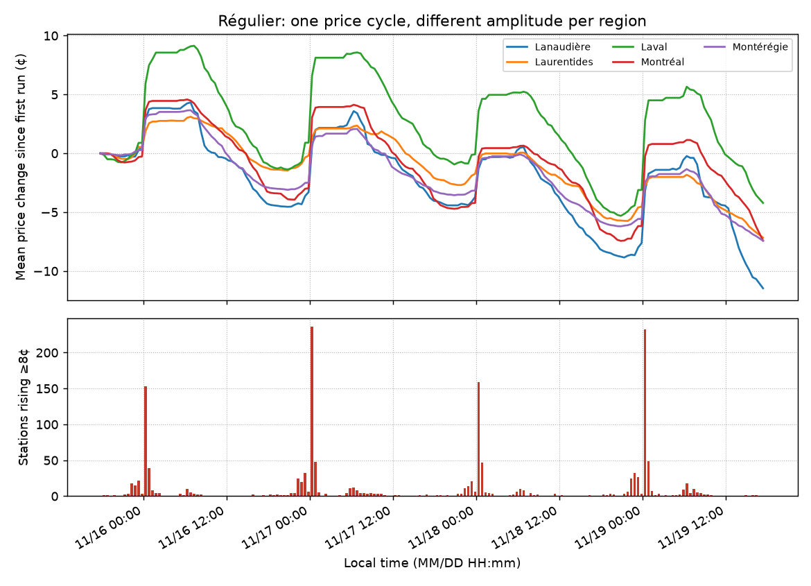
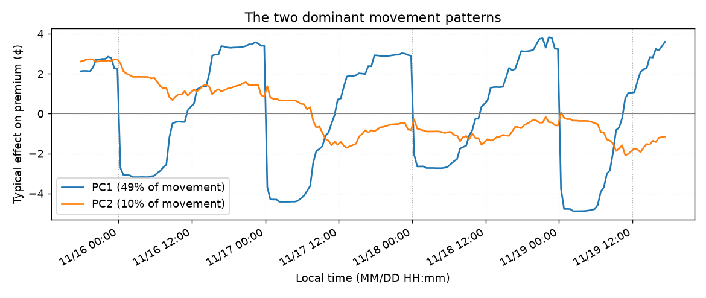
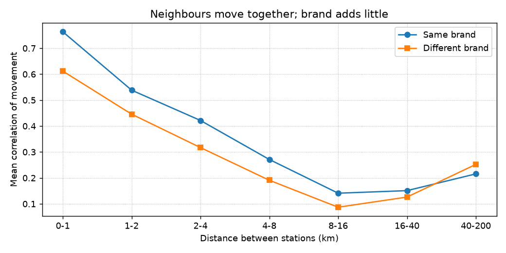

# Clustering on price history: analysis

This folder tests whether the station clusters should be fitted on **how prices move over time** instead of a single snapshot, and how
much that changes them. It is written so someone new to the project can follow the reasoning and re-run every number.
The design that follows from it is in [../plan.md](../plan.md).

**Data:** 95 hours (about 4 days) of Régulier prices, 191 runs, for 963 stations (Montréal, Laval, Montérégie, Lanaudière, Laurentides), fetched every 30 minutes
by the Raspberry Pi, 2026-11-15 17:50 to 2026-11-19 17:20 local time. Two stations that joined the feed mid-window have no full series and are left out of
sections 2-5, so those use 961 stations. The first version of this analysis used the first 27 hours (55 runs); where the result changed, it is noted.

## The question

The statistics page reports one price series per cluster. The clusters were fitted on one snapshot: each station became a point
`(x_km, y_km, price premium)` and Ward linkage grouped neighbouring stations with similar premiums. That cannot tell whether stations in a
cluster **trend together over a day**, which is what a cluster's average line implies. With history we can ask directly.

## Running it

```bash
uv run python design/history/clustering/export_history.py    # data/history.sqlite -> data/*.csv (read-only)
uv run python design/history/clustering/analysis.py          # output/analysis_report.md and three figures
uv run python design/history/clustering/ward_experiment.py   # output/ward_report.md and ward_results.csv
```

The CSV files in [data/](data) are committed, so the analysis can be re-run without the database (which is git-ignored). Rerun the export
when more history is available; the scripts take everything from the CSV files. All numbers below are from
[output/analysis_report.md](output/analysis_report.md) and [output/ward_report.md](output/ward_report.md).

| File | What it is |
|---|---|
| [export_history.py](export_history.py) | Standard library only. Copies the `stations`, `runs` and `price_changes` tables to CSV. |
| [analysis.py](analysis.py) | Sections 1-4 below. Prices are rebuilt per run from the stored changes (a price stays in force until the next change). |
| [ward_experiment.py](ward_experiment.py) | Swaps the feature matrix inside the project's own clustering code and scores the result on unseen prices. |
| [data/prices_regulier.csv](data/prices_regulier.csv) | Station × run price matrix that the analysis builds (handy for a notebook or spreadsheet). |

## Findings

### 1. The data is clean enough

191 runs, 30 minutes apart (longest gap 60 minutes, and only one gap over 45). 921 of 963 stations changed their Régulier price (median 14 changes);
42 never did. Diesel moves little (658 stations, median 2 changes), so only Régulier and Super carry a signal. One station left the feed before the last run, and
two joined it mid-window (stations 962 and 963, at runs 90 and 127).
`observed_at` is the *fetch* time and the first run records everyone's price as of then, so timing resolution is 30 minutes and the first
hours are not true change times.

### 2. A day is one price cycle



**The cycle repeats every day.** Around 00:20 local time, 153 (Monday), 236 (Tuesday), 159 (Wednesday) and 232 (Thursday) stations rise by 8¢ or more in
that single run, with smaller waves at 22:20-23:20 before it and 00:50 after it. The market median then climbs about 5-10¢ and declines over the day
(for example 167.9¢ at 02:50 Tuesday to 157.9¢ by 17:50). Steps are small and downward (median −2¢) except for the sharp rises (99th percentile +24¢).
Over the 4 days the whole cycle drifts down: the daily peak goes from 167.9¢ to 164.9¢ and the trough from 158.9¢ to 153.9¢.
Regions follow the same shape with different amplitude. Looking at the first jump (Sunday 17:50 to Monday 02:50): +8.6¢ in Laval, +4.5 in Montréal,
+3.5 in Montérégie, +3.8 in Lanaudière and +2.8 in Laurentides. Laval stays the most reactive region on later days.
This answers the open question of the 27-hour version, which had seen only one jump.

### 3. Level and movement are separate things, and movement is low-dimensional

Subtract the market median from each station's price to get its *premium*. A station's average premium (its **level**) differs between stations
by a standard deviation of 7.6¢, while its premium wobbles by about 3.8¢ over the window (10th-90th percentile 2.3-5.4¢). Removing each station's level leaves its **movement**.
The first principal component of the movement explains 49% of it (a reaction to the midnight jump, then recovery) and the second 10%; components 3-5 add 7%, 5% and 4%.
With 27 hours these were 58% and 15%, so more days show more variety in how stations move, but still a small number of patterns.

**What "movement" means.** Premium is a station's gap to the market (its price minus the market median at that run). Movement is how that gap
*changes* over time, relative to the station's own usual gap. It is zero for a station that keeps the same gap all day, however cheap or
expensive that station is. Example, with made-up prices (market median 160¢ before the midnight jump, 165¢ right after, 163¢ later):

| Station | Prices (before, after jump, later) | Premium (price − market) | Movement (premium − station's own average) |
|---|---|---|---|
| A | 158, 163, 161 | −2, −2, −2 | 0, 0, 0 |
| B | 160, 170, 166 | 0, +5, +3 | −2.7, +2.3, +0.3 |
| C | 160, 160, 160 | 0, −5, −3 | +2.7, −2.3, −0.3 |

A is a cheap station whose gap never changes, so its movement is zero. B jumped more than the market (its gap grew). C never changed its price, so
its gap shrank at the jump and partly recovered as the market came back down.



**Reading the figure.** Each curve is a shape that many stations share; a station's *score* on a component says how strongly it follows that
shape, and the curve is roughly the deviation in cents, from the station's usual gap, for a station that follows it fully.

- PC1 is a sawtooth that repeats every night. It is high in the evening (about +3¢), drops sharply at the 00:20 jump to between −3¢ and −5¢,
  stays low until the morning, and recovers over the day, reaching the evening level again before the next jump. That is station C's pattern:
  a station with a positive score followed the jump *less* than the market, and one with a negative score (like B) followed it *more*. The main
  difference between stations is therefore how strongly they reacted to the midnight jump. The drop is about 6-9¢ from peak to trough, and it
  is a little deeper on the later nights. The sign of a component is arbitrary (the flipped curve is equally valid), so only the shape matters.
- PC2 is a slow drift, not a daily shape: it falls from about +2.6¢ on the first evening to about −1.5¢ by the last day, with small steps
  at the midnight jumps. Stations with a high score were relatively dear at the start of the window and relatively cheap by the end, or the
  reverse for a low score. It is the second most important pattern (10%) but it may be a one-off change in some stations' pricing over these
  4 days rather than something that recurs, which only a longer window can tell. At 27 hours this component looked like a mid-morning bump;
  it was an artefact of the short window.
- The y-axis is **not a price** and the curves do not say when gas is cheap. The market-wide pattern, including the +5¢ jump itself, is removed
  when the market median is subtracted. When the market is cheapest (the evening, section 2) is a separate question.

So a few numbers describe how a station moves, which is why a short trajectory is a reasonable feature for clustering.

### 4. Stations that move together are neighbours; brand matters much less



The mean correlation of two stations' movement falls from 0.63 under 1 km to 0.21 at 4-8 km and 0.10 at 8-16 km. Same-brand pairs add about
0.1 at equal distance. Asking which grouping explains the variation between stations (adjusted R²; area = 5 km grid cell):

| Feature | Brand | Area | Region |
|---|---|---|---|
| Average premium (level) | 0.11 | 0.45 | 0.04 |
| Premium volatility | 0.03 | 0.58 | 0.11 |
| Decay rate after the midnight jump | 0.02 | 0.43 | 0.02 |
| Size of the midnight jump | 0.12 | 0.34 | 0.04 |

Every feature is better explained by *where* a station is than by its brand. A station also resembles the mean of its six nearest neighbours
(correlation 0.57-0.76). This is the property that makes a map of contiguous clusters sensible, and it matches the way the clusters are built.
Beyond 40 km the correlation rises again (0.25); only part of that is explained by region (same-region 0.37, different-region 0.22), and
I have not established the cause. It does not affect contiguous clusters.

### 5. Does fitting on history produce better clusters? No clear evidence, at 4 days

Clusters were built with the project's pipeline (graph, Ward, merge of small clusters, size cap of 75) and about 19 clusters, changing only
the features. To test generalization, each variant was fitted on one half of the window and scored on the other half, in both directions
(see [ward_experiment.py](ward_experiment.py)). *Shape R²* is the share of movement variance a clustering explains (does it group stations
that move alike?), *level R²* the same for average premium. Each half is now about 2 days.

| Features | Out-of-sample shape R² | Out-of-sample level R² | Out-of-sample corr |
|---|---|---|---|
| Geography only | 0.299 | 0.210 | 0.40 |
| Snapshot premium (today) | 0.313 | 0.231 | 0.42 |
| Window-average premium (weight 3) | 0.274 | 0.208 | 0.45 |
| Hourly premium trajectory (weight 3) | 0.311 | 0.233 | 0.45 |
| Shape only (weight 6) | 0.298 | 0.209 | 0.43 |

(Other weights are in [output/ward_report.md](output/ward_report.md); 1.5-6 differ by at most 0.01 for trajectory and shape.)

**The best four variants (snapshot, trajectory, geography, shape-only) are within 0.015 of each other in shape R²; only the window-average premium is clearly lower (0.274).**
The clusters fitted by different methods agree with each other at an adjusted Rand index of 0.80-0.89 (it was 0.86-0.96 at 27 hours), so boundaries
are somewhat less stable than first thought. What the data supports is:

- Geography accounts for nearly all of the structure. Price features nudge the boundaries; they do not reshape the map.
- The trajectory at weight 3 has the best level R² (0.233) and, with the window average, the best correlation (0.45), but only by 0.002 over the snapshot on level R². This is not a result.
- Shape-only features, which looked best at 27 hours (0.345 at weight 6, against 0.335 for geography), are now no better than geography (0.298 against 0.299). The earlier edge
  was probably noise from one midnight jump.
- The snapshot is as good as the trajectory on this measure. A trajectory can still express "moves together", which a snapshot cannot by
  construction, but the data does **not** show that using it gives better clusters.
- Absolute scores fell (shape R² about 0.30-0.31 against 0.33-0.35), partly because halves of two days each contain different parts of the cycle.

An earlier, rougher run (a hand-written Ward without the size cap, one split) showed the snapshot clearly worst. The project's real pipeline
with two folds has never reproduced that gap, at 27 hours or at 4 days, so it is not claimed here.

### 6. Was the snapshot lucky? Partly: the time of the snapshot matters

The clusters in use today were fitted on one snapshot. [snapshot_timing.py](snapshot_timing.py) repeats that fit at 32 different times (every
3 hours across the window) and scores each result on the whole window, with the same pipeline and about 19 clusters
([output/snapshot_timing_report.md](output/snapshot_timing_report.md)).

| | Shape R² | Level R² |
|---|---|---|
| Snapshot, worst of 32 | 0.229 | 0.170 |
| Snapshot, median | 0.291 | 0.215 |
| Snapshot, best | 0.308 | 0.237 |
| Geography only | 0.290 | 0.211 |
| Trajectory (weight 3, fitted on the whole window, so in-sample) | 0.309 | 0.230 |

- **The typical snapshot is no better than geography alone** (median 0.291 against 0.290), and 17 of 32 beat geography. Most of what a snapshot adds is noise.
- **A bad snapshot is worse than no price information at all.** The six worst are all at 08:50 or 11:50, on every one of the 4 days (when prices are
  recovering from the midnight jump and stations are at different points of the cycle): 0.229-0.264 against 0.290 for geography. Snapshots from 12:00 to 23:59 average about 0.30,
  those from 00:00 to 05:59 about 0.29 and those from 06:00 to 11:59 about 0.26.
- **The best snapshots match the trajectory** (0.308 against 0.309), which is the upper bound of what history gave in these tests. Only 6 of 32 snapshots are within 0.01 of it.
- **The hypothesis that quiet moments (stations close in price) are the weak ones is not supported.** The correlation between the spread of prices at the snapshot and its score is only 0.33.
  The lowest-spread snapshots (about 5.9-6.0¢, at night) scored at the median (0.288-0.291), the highest-spread ones (8.1¢, at 23:50) did too, and the best snapshot (Thursday 14:50, 7.7¢)
  was in the middle of the range. What separates good from bad is the phase of the daily cycle: mid-morning is bad whatever the spread (6.1-7.0¢ for the worst).
- The first snapshot used for the frozen clusters is not one of these 32, so how lucky it was is not known. Under this test the expected outcome of a random snapshot is
  "as good as geography", with a risk of doing worse and a chance of doing as well as the trajectory.

So the 4-day comparison in section 5 (snapshot 0.313 against trajectory 0.311) was for the last run of each half, which happened to be a good time. The
fair comparison is the table above: the trajectory is about as good as the best snapshot, better than the typical one, and does not depend on when it was taken.

## Why Ward linkage

Everything above varies the *features* and keeps the *algorithm* fixed: Ward agglomerative clustering, restricted to a graph of each
station's 6 nearest neighbours (edges over 8 km dropped), cut at a threshold searched until about 19 clusters remain, then small
clusters merged and clusters over 75 stations re-split. This section records why Ward was chosen and what it costs.

**Evidence level.** The experiment compared feature sets, not algorithms. The case for Ward below is from how the methods work and what the
statistics page needs; I did not benchmark k-means, DBSCAN or the other linkages on this data. Treat the alternatives column as reasoning, not a result.

### What the task needs

1. **Contiguous clusters.** A cluster is a place on a map, and section 4 shows that neighbours move together.
2. **A cluster mean that represents its members.** The statistics page draws one line per cluster, which only makes sense if the stations
   under it are similar. That is a within-cluster variance criterion, and it is exactly what the R² scores in section 5 measure.
3. **Roughly 19 clusters, finer in dense areas.** The count is a product decision (a readable chart), but the boundaries should come from
   the data, not from hard-coded areas.
4. **Repeatable and cheap.** About 960 points, re-fitted rarely, and the result is frozen in the database.

### Why Ward fits

- **It optimizes the right thing.** Each merge is the one that increases total within-cluster variance the least. Low variance within a cluster means the cluster
  average is a fair summary, which is requirement 2 stated as an algorithm.
- **Compact, comparable clusters.** Minimum-variance merging avoids very long or very uneven clusters, so a cluster reads as a neighbourhood
  or town, not a corridor.
- **Contiguity is built in.** scikit-learn's `AgglomerativeClustering` takes a connectivity graph and only merges clusters that share an edge. No
  post-processing is needed to keep clusters connected, and the 8 km edge limit separates distant stations automatically.
- **Hierarchical, so the count is tunable.** One tree gives any number of clusters. The threshold can be searched for a target count, and an
  oversized cluster can be re-split with a second Ward run on only its members (the size cap).
- **Deterministic.** No random start, so the same data gives the same clusters, which suits a re-fit that is compared against the frozen assignment.
- **Handles both feature types in one distance.** Position (km) and price premium (cents × `alpha`) enter a single Euclidean distance, and
  `alpha` is the one knob for how much price can bend the geography.

### Why not the alternatives (reasoning only)

| Method | Why it fits less well |
|---|---|
| k-means / Gaussian mixture | Same variance objective, but no contiguity constraint: a cluster can include stations on both sides of the river or two towns with a gap between them. Needs k up front and depends on a random start. |
| DBSCAN / HDBSCAN | One density setting cannot suit both the Montréal island and rural Lanaudière: it either splits the rural areas apart or merges the whole city into one cluster. It also labels sparse stations as noise with no target count. |
| Single linkage | Chains through continuous urban sprawl, so one long thin cluster swallows a corridor of stations. |
| Complete / average linkage | Contiguous with a graph, but they optimize cluster diameter or average distance, not variance, so the cluster mean is less well supported as a summary. |
| Graph community detection (Louvain, spectral) | Plausible, since the neighbour graph already exists. Less direct control over cluster count and size, and the features would have to be turned into edge weights. Not tried. |

### Main weaknesses to consider

- **Greedy and irreversible.** A merge is never revisited, so an early mistake stays. The result is a good partition, not the best one, and the boundaries of
  neighbouring clusters can shift when stations are added or prices change. Section 5 found variants agree at an adjusted Rand index of only 0.80-0.89,
  so boundaries are not fully stable. This is the reason the assignment is **frozen** and re-fitted manually.
- **Prefers round, even-sized clusters.** Ward does not model density, so a sparse rural area and a dense urban one both end up forced into similarly sized
  groups. The size cap of 75, the small-cluster merge and the 12-station minimum exist to correct this, and each adds a parameter.
- **Sensitive to scaling.** Kilometres and cents are different units, and `alpha` (currently 1.5) is a judgment call that changes what a cluster means. Section 5
  shows that price features move the score by about 0.01-0.04, mostly within noise, so the setting is hard to tune from data.

**Practical conclusion.** Ward is a good default because it is the only common method that gives contiguous, variance-minimizing, count-controllable clusters
with one library call. If a later analysis (7 days, below) shows unstable boundaries, the first thing to try is
a graph-based method on the same neighbour graph, scored with the same out-of-sample R² as in [ward_experiment.py](ward_experiment.py).

## What would change the conclusion

This was re-run at 4 days. Re-run `export_history.py`, `analysis.py` and `ward_experiment.py` again at **7 days**. Status of the checks:

1. Does the midnight jump repeat? **Yes**, on all 4 days (section 2). A 24-hour profile (the median premium for each hour of the day across days) is now a sound feature.
2. Does the gap between trajectory features and geography grow with more cycles? **No.** The trajectory's shape R² edge over geography was +0.006 at 27 hours and +0.012 at 4 days, both within noise.
3. Do the clusters remain stable between halves of the window? **Only partly**: in-sample and out-of-sample scores are close (trajectory at weight 3: 0.315 and 0.311), but the variants agree at only 0.80-0.89 adjusted Rand.
4. Do bimodal areas (e.g. Saint-Jean-sur-Richelieu: 147-157¢ against 166-170¢) separate once movement is available? **Not checked yet.**
